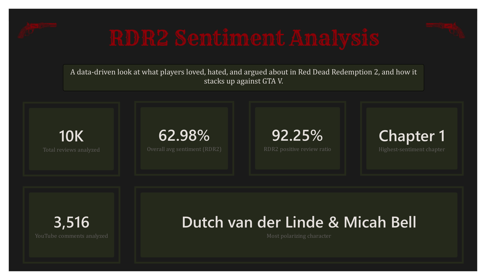
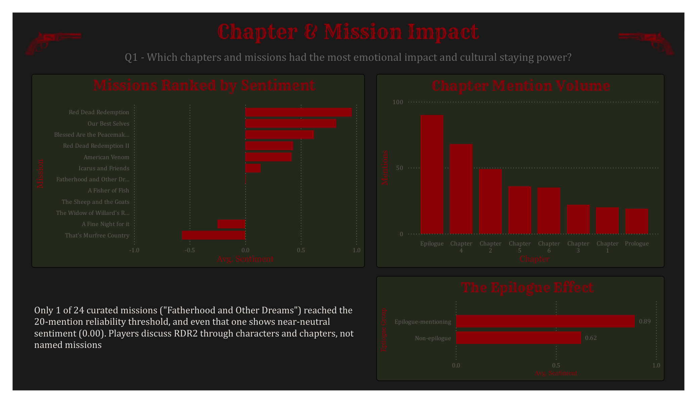
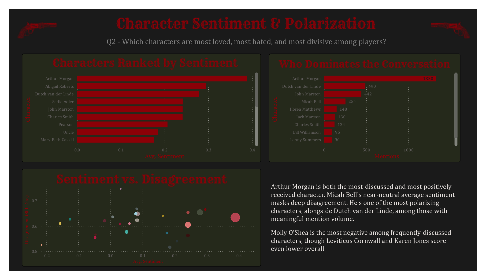
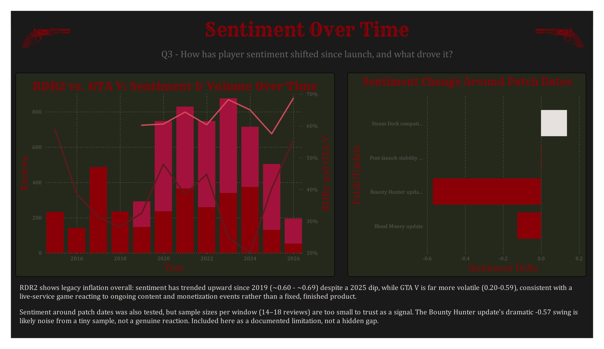
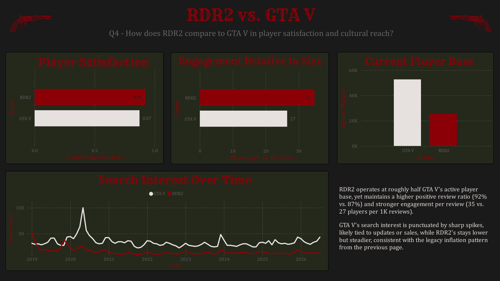

**[View the interactive Power BI report](https://app.powerbi.com/view?r=eyJrIjoiZmE0YmFiOTAtODE2Yi00MDZhLWFkNzYtZTc3NDRjY2M1YWNmIiwidCI6Ijg0MDAyOWEzLTc5ZmYtNDBmZS1hZGYyLTk4MTZmY2JmYzc2NyIsImMiOjh9)**

# Red Dead Redemption 2: Sentiment Analysis

What players loved, hated, and argued about in Red Dead Redemption 2, and how its reception compares to GTA V. The project combines Steam reviews, YouTube comments, and engagement data in a Python pipeline (sentiment scoring and entity matching), with results presented in a Power BI report and a slide deck.



## Research questions

1. **Chapters and missions**: which parts of the story had the most emotional impact and the most lasting discussion?
2. **Characters**: which characters are most loved, most disliked, and most divisive?
3. **Sentiment over time**: how has reception shifted since the 2019 PC launch, and what drove it?
4. **RDR2 vs. GTA V**: how do the two Rockstar titles compare on satisfaction and engagement?

## Key findings

**Chapters and missions**
- **Chapter 1 has the highest average sentiment (0.73)**, while **the Epilogue is the most-discussed chapter (90 mentions)** and close behind on sentiment (0.64). Chapter 5 (Guarma) scores lowest (0.27).
- **The epilogue effect**: RDR2 reviews that mention the epilogue average **0.89** sentiment, against **0.62** for those that don't (n = 59 vs. 2,941). Epilogue-mentioning reviews were spot-checked to rule out duplicates or copy-paste artifacts.
- **Players don't talk about named missions.** Only 1 of 24 curated missions reached the 20-mention reliability threshold. Players discuss the game through characters and chapters instead.

**Characters**
- **Arthur Morgan dominates**: 1,330 mentions (over a third of all character mentions) and the highest sentiment (0.39). Only 7 of 25 characters pass 100 mentions.
- **Dutch van der Linde and Micah Bell are the most polarizing**: high discussion volume combined with the widest spread of opinion (standard deviation ≈ 0.65). Micah's near-neutral average (0.08) hides strong disagreement rather than indifference.
- **Leviticus Cornwall (-0.22) and Karen Jones (-0.16) score lowest overall.** Among the most-discussed cast, Molly O'Shea is the most negative (-0.13).

**Sentiment over time**
- **RDR2 has aged well**: average sentiment rose from about 0.60 after the 2019 PC launch to about 0.69, despite a dip in 2025 (0.57).
- **GTA V is far more volatile** (0.20–0.59), consistent with a live-service game reacting to ongoing content and monetization changes.

**RDR2 vs. GTA V**
- RDR2 has a higher share of positive reviews (**92.2% vs. 87.4%**) and more active players per 1,000 reviews (**34.8 vs. 26.5**), despite roughly half of GTA V's active player base.
- GTA V draws about **2.3× more search interest** on Google Trends (average index 33.1 vs. 14.6, a 69% / 31% share of combined interest).

## Report pages

| | |
|---|---|
|  |  |
|  |  |

## Data

| Source | What was collected |
|---|---|
| Steam reviews | 10,000 English reviews: 5,000 per game (2,000 most recent and 3,000 from across the full review history) |
| YouTube Data API v3 | 3,516 top comments from videos about the curated missions and characters, plus video statistics |
| Steam Web API & SteamSpy | Current player counts, review totals, owner and playtime estimates (snapshot) |
| Google Trends | Relative search interest for both games, 2019–2026 |
| IGDB (via Twitch OAuth) | Official character information |

The character and chapter analysis uses the **8,516 RDR2 texts** (5,000 Steam reviews and 3,516 YouTube comments). The 10,000-review figure in the report covers both games. Data was collected in July 2026; player counts and review totals are a point-in-time snapshot.

## Method

```
APIs → data collection (Python) → sentiment scoring (VADER + custom lexicon)
     → entity matching (regex) → aggregation → charts (matplotlib) + Power BI report
```

- **Sentiment scoring**: [VADER](https://github.com/cjhutto/vaderSentiment), extended with a 7-term lexicon override for gaming language. Words like "destroyed", "wrecked" or "gutted" are negative in general English, but in game reviews they usually describe strong emotional impact ("this ending destroyed me").
- **Entity matching**: word-boundary regex against curated reference lists of 8 chapters, 24 missions and 25 characters, including alternative names. False positives were audited and fixed:
  - Two missions share their names with the game itself ("Red Dead Redemption" and "Red Dead Redemption II"), which caused 601 false matches. Matching those missions only on their alternative phrases reduced this to 2.
  - The Epilogue was originally split into two parts, but reviews never distinguish them, so they were merged. "John Marston" was removed as an Epilogue identifier, since it matched any mention of the character.
- **Reliability threshold**: entities with fewer than 20 mentions are **flagged as low confidence, not removed**, so thin results stay visible without being overstated.
- **Polarization**: kept as two separate metrics, since "polarizing" has no single definition: *raw* (mention count × sentiment standard deviation) and *per mention* (standard deviation alone).

## Limitations

- **Patch-date effects were inconclusive.** Sentiment in the 14 days after five major updates was compared with the baseline, but each window held only 14–18 reviews. The largest swing (-0.57 after the Bounty Hunter update) is most likely noise. The analysis is kept and documented rather than dropped silently.
- **VADER is lexicon-based**: it doesn't understand sarcasm or context beyond its word list and the custom overrides.
- **Samples aren't random**: Steam's historical reviews are ordered by helpfulness and YouTube comments by relevance, which favors visible, popular opinions.
- **Regex matching misses** nicknames, misspellings and indirect references, so mention counts are lower bounds.
- **English-language reviews only.**

## Repository structure

```
├── README.md
├── notebooks/
│   ├── 00_api_connectivity_test.ipynb   # checks that all API keys load and every source responds
│   ├── 01_data_collection.ipynb         # collects reviews, comments, metadata; builds reference lists
│   ├── 02_sentiment_analysis.ipynb      # sentiment scoring, entity matching, aggregation
│   └── 03_visuals_export.ipynb          # matplotlib charts with written interpretation
├── data/
│   ├── reference/      # curated chapter, mission, character and patch-date lists
│   └── processed/      # aggregated results and public metadata (no individual reviews)
├── charts/             # chart images exported by notebook 03
├── report/
│   ├── RDR2_report.pdf          # Power BI report (5 pages)
│   ├── RDR2_presentation.pdf    # slide deck
│   └── RDR2_PB_Theme.json       # custom Power BI theme
└── images/             # report screenshots used in this README
```

## Data privacy

- **Raw reviews and comments are not included.** They contain other users' review texts, usernames and identifiers. The repository only holds aggregated results and public metadata (video titles, view counts, character information).
- **The Power BI file (`.pbix`) is not included** for the same reason: its data model contains the raw review and comment tables. The report is available as a PDF instead.
- **API keys are never stored in the notebooks.** They are loaded from a local `.env` file, which is excluded from the repository.

## How to reproduce

1. Get API credentials for the **Steam Web API**, **YouTube Data API v3** and **IGDB** (a Twitch developer application).
2. Create a `.env` file in the `notebooks/` folder:
   ```
   STEAM_API_KEY=your_key
   YOUTUBE_API_KEY=your_key
   IGDB_CLIENT_ID=your_client_id
   IGDB_CLIENT_SECRET=your_client_secret
   ```
3. Install the packages:
   ```
   pip install pandas requests python-dotenv vaderSentiment pytrends matplotlib
   ```
4. Create an empty `data/raw/` folder, then run the notebooks in order from the `notebooks/` folder: `00` → `01` → `02` → `03`.

The APIs return live data, so a new run will collect different reviews and comments, and the results will differ somewhat from those above. The 49 YouTube searches cost 100 quota units each, about half of the free daily quota of 10,000 units.

## Tools

Python (pandas, requests, vaderSentiment, pytrends, matplotlib, python-dotenv) · Jupyter · Power BI · PowerPoint
